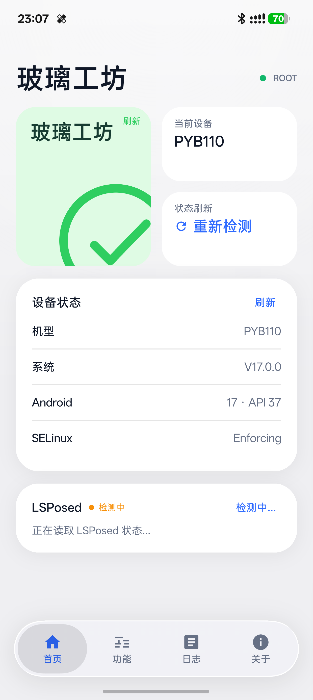
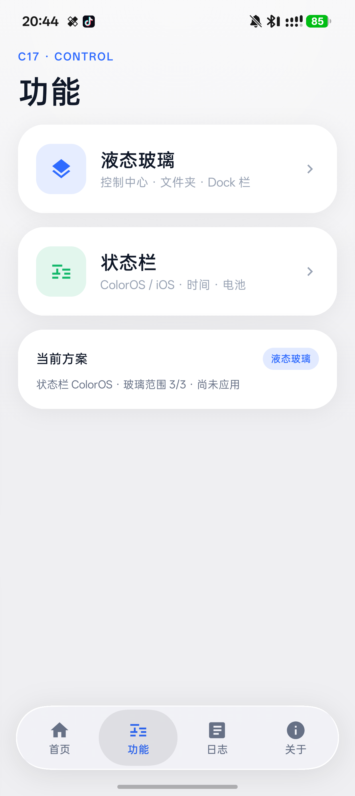
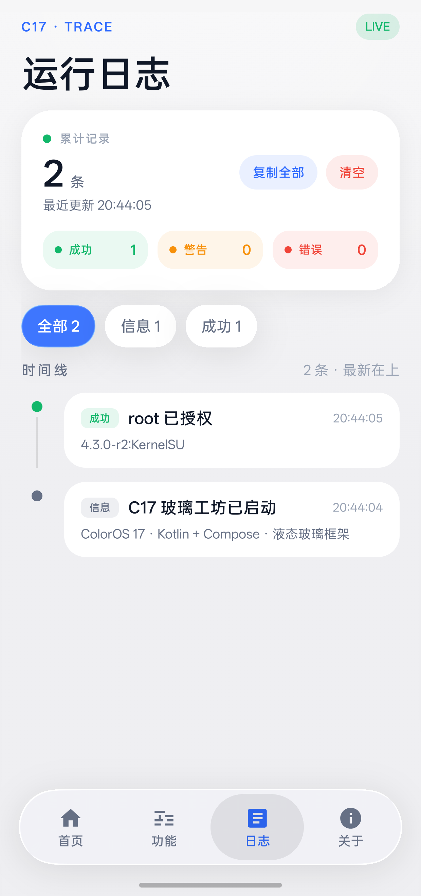

# C17 玻璃工坊

面向 **ColorOS 17 / Android 17 root 用户** 的系统界面定制 App。采用 Kotlin + Jetpack Compose 构建，内置 AGSL 液态玻璃底部导航与系统级折射渲染注入。

> 项目仓库：<https://github.com/hei1345hei-hub/Glass-Workshop>  
> 最新 APK：<https://github.com/hei1345hei-hub/Glass-Workshop/releases/latest>  
> 问题反馈：<https://github.com/hei1345hei-hub/Glass-Workshop/issues>

<p align="center">
  
  
  
</p>

## 功能

- 四栏结构：首页 / 功能 / 日志 / 关于
- 功能页双入口：液态玻璃 / 状态栏
- 液态玻璃覆盖控制中心、通知中心、音量条、桌面文件夹与 Dock 栏
- 支持折射强度、控制中心模糊、桌面与 Dock 模糊、圆角半径与高光描边调节
- 状态栏支持 ColorOS / 仿 iOS 样式、电池/信号/静音/5G 布局与实时预览
- 液态玻璃底部导航：blur、lens、vibrancy、按压折射
- 左右滑动切换页面，底栏点击与 Pager 双向同步
- 顶部状态栏沉浸式：内容滚动时可进入状态栏图标区域
- root 状态、设备信息、ColorOS 版本检测
- 配置写入 `/data/local/tmp/c17_glass/config.json`，支持热重载参数
- LSPosed 模块识别：C17 模块状态、系统界面与系统桌面作用域状态、双端进程重启
- 首页 LSPosed 状态卡：快捷显示「已启用 / 未启用」，点按重新检测
- 安全基线：应用前自动备份，失败自动回滚，功能页支持一键全部还原（含 SystemUI 与系统桌面）
- 日志概览、级别筛选、时间线、清空与复制
- 深色 / 浅色 / 跟随系统主题
- 关于页内置使用教程、仓库、问题反馈和微信赞赏码，支持点按展开介绍与主题选择

## 下载与安装

1. 打开 [Releases](https://github.com/hei1345hei-hub/Glass-Workshop/releases/latest)，下载最新版 `C17-Glass-Workshop-v1.0.24.apk`。
2. 允许浏览器或文件管理器安装未知来源应用。
3. 安装后打开「C17 玻璃工坊」，在 KernelSU / Magisk 中授予 root 权限。

ADB 安装：

```powershell
adb install -r C17-Glass-Workshop-v1.0.24.apk
```

最低系统为 Android 12（API 31），当前主要在 OnePlus / ColorOS V17 / Android 17 上测试。

## 使用教程

### 1. 授予 root

打开 KernelSU / Magisk，为「C17 玻璃工坊」授予 root。首页右上角出现 `ROOT` 绿点即表示 root 链路正常。

### 2. 启用 LSPosed 模块

在 LSPosed 管理器中启用「C17 玻璃工坊」，并在推荐作用域中勾选 **系统界面**（`com.android.systemui`）与 **系统桌面**（`com.android.launcher`）。作用域只能在 LSPosed 内申请，App 只负责检测和回显，不会修改 LSPosed 配置。

### 3. 调整状态栏

进入「功能」→「状态栏」：

- ColorOS / iOS 两种样式，iOS 预览包含灵动岛
- 时钟显示秒数、居中时钟、状态栏网速、电池百分比、图标着色、仿电池外观、单双层信号、静音、蓝牙、5G 位置等开关与预览
- 状态栏透明度：拖动滑块调节，点击轨道空白处不会误触发
- 修改后点「重启作用域」，配置写入 `/data/local/tmp/c17_glass/config.json`

### 4. 液态玻璃范围与参数

进入「功能」→「液态玻璃」：

- 玻璃范围支持独立开关：控制中心、通知中心、音量条、桌面文件夹、Dock 栏
- 参数支持滑块与开关调节：折射强度（`0%..100%`）、控制中心模糊（`4dp..64dp`）、桌面与 Dock 模糊（`2dp..32dp`）、圆角半径（`8dp..48dp`）、高光描边

### 5. 重启系统作用域

功能页「配置摘要」只有一个「重启作用域」按钮：点击写入配置并同时重启 `com.android.systemui` 与 `com.android.launcher`，让两个作用域一起重新加载玻璃；两次重启之间强制 90 秒冷却，冷却内点击只写配置不重启，避免频繁重启被 LSPosed 判定为崩溃循环而进入安全模式。首页 LSPosed 卡与关于页也提供「重启系统作用域」入口。

### 6. 主题与日志

- 关于页可切换「跟随系统 / 浅色 / 深色」
- 日志页按级别筛选，支持复制全部，反馈问题时请附上相关日志

## 安全与回滚

应用前会建立一次安全基线，保存在 `/data/adb/c17_glass_safety`，并镜像一份恢复脚本到 `/data/local/tmp/c17_glass/restore.sh`。

基线覆盖：

- `secure.clock_seconds` 的原始值
- `/data/local/tmp/c17_glass/config.json`（这是 App 生成文件，还原时删除）
- 通过 `SafetyManager.backupFile()` 登记的后续系统文件

应用流程的安全门：

1. 备份建立失败时直接拒绝应用，不修改系统
2. 任一执行项失败或 SystemUI 未恢复时自动回滚
3. 应用未确认时，下次打开 App 自动回滚
4. 功能页「全部还原」会删除配置并同时重启 `com.android.systemui` 与 `com.android.launcher`，恢复系统界面与桌面原生效果

App 打不开时，在 KernelSU / Magisk 的 root 终端执行：

```sh
sh /data/local/tmp/c17_glass/restore.sh
```

也可以执行 `/data/adb/c17_glass_safety/restore.sh`。

注意：这是降低 root 改动风险的回滚机制，不能承诺绝对避免变砖。如果整机完全无法启动，App 内按钮和脚本都无法运行，需要使用 root 管理器的安全模式、ADB 或恢复模式。后续新增系统文件改动时，必须先调用 `SafetyManager.backupFile()` 再写入。

## 构建

环境要求：

- JDK 17+（本机验证 JDK 21）
- Android SDK Platform 37
- Build-Tools 37.0.0

```powershell
# 将 JAVA_HOME / ANDROID_HOME 指向本机 JDK 与 Android SDK 安装目录
$env:JAVA_HOME="<JDK 安装目录>"
$env:ANDROID_HOME="<Android SDK 目录>"

.\gradlew.bat --no-daemon :app:assembleDebug
```

产物：

```
app/build/outputs/apk/debug/app-debug.apk
```

## 代码结构

```
app/src/main/java/
├── com/c17/glass/
│   ├── MainActivity.kt              # 沉浸式窗口、刷新率与配置装载
│   ├── core/
│   │   ├── RootShell.kt             # su 执行、超时、RootState、设备信息
│   │   ├── TweakConfig.kt           # 配置模型与 SettingsStore
│   │   ├── TweakEngine.kt           # 执行计划、JSON 下发与进程热重载/重启
│   │   ├── SafetyManager.kt         # 安全基线、备份、自动回滚与恢复脚本
│   │   ├── LsposedRepository.kt     # LSPosed DB 读取、模块/双作用域状态
│   │   └── LogRepository.kt         # 分级日志
│   ├── ui/
│   │   ├── GlassApp.kt              # 背景层 + HorizontalPager + 玻璃导航
│   │   ├── GlassBackground.kt       # 静态渐变背景
│   │   ├── theme/Theme.kt           # 深浅色 token
│   │   ├── components/              # 卡片、开关、滑杆、按钮、图标、底栏
│   │   ├── utils/                   # 弹簧动画、按压高光、手势识别
│   │   └── screens/                 # 首页 / 功能 / 日志 / 关于
│   └── xposed/
│       ├── C17GlassModule.kt        # LSPosed 入口（SystemUI + Launcher）
│       ├── glass/                   # 原生 AGSL 折射玻璃、桌面文件夹、Dock 与长按弹窗 Hook
│       └── statusbar/               # 状态栏拓展适配框架（开发中）
```

## 配置契约

「应用」后写入：

```
/data/local/tmp/c17_glass/config.json
```

示例：

```json
{
  "clockSeconds": false,
  "centerClock": false,
  "networkSpeed": false,
  "batteryPercent": true,
  "iconTint": false,
  "iconTintColor": "#2F6BFF",
  "statusBarAlpha": 0.12,
  "iosStatusBar": true,
  "iosTime24Hour": false,
  "iosBatteryStyle": true,
  "iosMuteIcon": false,
  "iosDoubleSignal": false,
  "iosBluetoothIcon": false,
  "ios5gPosition": "DEFAULT",
  "glassControlCenter": true,
  "glassNotifications": true,
  "glassVolume": true,
  "glassFolders": true,
  "glassDock": true,
  "refraction": 0.78,
  "blurRadius": 24.0,
  "launcherBlurRadius": 10.0,
  "highlight": true,
  "cornerRadius": 26.0
}
```

SystemUI 与 Launcher 侧由 LSPosed 模块读取该文件并支持参数热重载。该文件由 App 生成，执行「全部还原」时会删除并同时重启 `com.android.systemui` 与 `com.android.launcher`。

目前已接通：

- root 状态检测、`su -v`、ColorOS / Android / SELinux 信息
- LSPosed 新旧 schema 的模块与双作用域状态读取
- 控制中心、通知中心、音量条（`SystemUI` 原生 AGSL 管线）及桌面文件夹、Dock 栏（`Launcher` UniRender 管线）液态玻璃注入
- 折射强度、控制中心模糊、桌面与 Dock 模糊、圆角半径、高光描边滑块与开关（支持免重启热重载）
- 仿 iOS 电池、单双层信号、静音图标、状态栏图标着色与 5G 位置调节
- 「全部还原」一键清理配置并重启 SystemUI 与系统桌面

## 渲染注意

`layerBackdrop` 会把所在节点的内容录制成 `GraphicsLayer`，玻璃组件通过 `drawBackdrop` 采样这张图。

**玻璃组件不能放在 `layerBackdrop` 节点内部**，否则会把自己绘制进折射源，形成自引用 DisplayList，`libhwui` 的 `RenderNode::prepareTreeImpl` 会递归到栈溢出（SIGSEGV）。

当前结构：

- `GlassBackground` 单独放在 `layerBackdrop` 里，作为唯一折射源
- Pager、GlassCard、导航栏都在 `layerBackdrop` 之外，只消费 backdrop
- 背景层保持静态，避免每帧重录整屏

## 问题反馈

提交 Issue 时请附上：

- 机型、ColorOS / Android 版本
- App 版本
- 复现步骤
- 日志页相关日志或 Logcat
- 如果涉及 LSPosed，请说明模块与作用域状态

反馈地址：<https://github.com/hei1345hei-hub/Glass-Workshop/issues>

## 赞助与支持

<p align="center">
  
</p>

如果这个项目对你有帮助，可以用微信扫码请作者喝杯咖啡，金额随意。

也可以：

- 给仓库点一个 Star
- 在 [Issues](https://github.com/hei1345hei-hub/Glass-Workshop/issues) 留言「赞助」
- 提交 Bug、适配建议或 Pull Request

## 致谢与借鉴声明

- **[Kyant0 / AndroidLiquidGlass](https://github.com/Kyant0/AndroidLiquidGlass)**：本应用的 Compose 液态玻璃渲染核心（`com.kyant.backdrop` / `com.kyant.shapes`）及悬浮液态玻璃底部导航栏交互实现（`LiquidTabBar` / `DampedDragAnimation` / `InteractiveHighlight` 等组件）借鉴并参考了该开源项目。上游代码以 Apache-2.0 许可证随仓库分发，许可证文本见 `LICENSES/Apache-2.0-Kyant0.txt`。

## 风险说明

修改 SystemUI、重启系统界面、写入 `/data` 均有风险。请先备份，明确命令含义后再执行。本项目不做任何绕过系统安全机制的实现。
